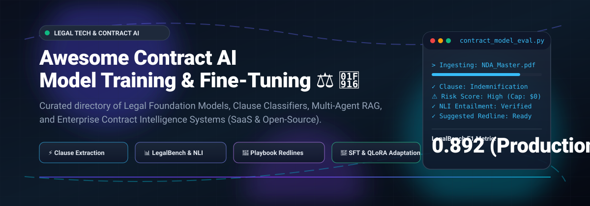
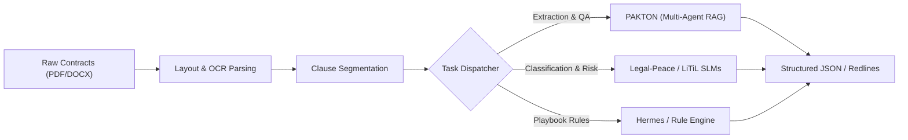

  

# Awesome Contract AI Model Training & Fine-Tuning ⚖️ 🤖

  
  
  
  
  

> 📚 A curated directory of state-of-the-art **Contract AI model training frameworks, fine-tuning recipes, legal LLMs, and contract review platforms** (SaaS & open-source).

A comprehensive guide to domain adaptation for legal foundation models, covering **contract analysis, clause classification, contract reasoning, legal NLI (Natural Language Inference), automated redlining, and risk scoring**.

---

## 📑 Table of Contents

- [🔍 Overview & Key Concepts](#-overview--key-concepts)
- [📊 Sector Overview & Market Dynamics](#-sector-overview--market-dynamics)
- [🏢 SaaS & Enterprise Hosted Platforms](#-saas--enterprise-hosted-platforms)
- [💻 Open-Source Repositories & Models](#-open-source-repositories--models)
  - [Open-Source Projects Sorted by GitHub_Stars](#open-source-projects-sorted-by-github-stars)
- [🏗️ Architectural Patterns for Custom Contract AI](#️-architectural-patterns-for-custom-contract-ai)
- [📈 Star History](#-star-history)
- [☕ Support & Community](#-support--community)
- [🤝 How to Contribute](#-how-to-contribute)
- [⚠️ Disclaimer](#️-disclaimer)

---

## 🔍 Overview & Key Concepts

Training and fine-tuning domain-specific AI for contracts requires specialized approaches beyond generic LLMs:

- 📑 **Clause Extraction & Classification**: Identifying standard clauses (e.g., Indemnification, Non-Disclosure, Termination, Limitation of Liability) using token-level or sequence-level classification.
- ⚖️ **Contract NLI (Natural Language Inference)**: Determining whether a contract entails, contradicts, or remains neutral toward hypothesis obligations and covenants.
- ✍️ **Playbook Enforcement & Redlining**: Validating agreements against company-specific negotiation rules and generating automated redlines.
- 🛡️ **Data Sovereignty & On-Premises Privacy**: Leveraging open-source fine-tuned weights (LoRA/QLoRA) deployed inside private VPCs or on-premise infrastructure to protect client confidentiality.

---

## 📊 Sector Overview & Market Dynamics

The global Legal AI and Contract Lifecycle Management (CLM) software market is estimated at **$3.26B to $4.05B in 2025–2026**, on pace to surpass **$28B+ by 2035** with an annual growth rate (CAGR) exceeding 24%. The contract intelligence sector is **moderately fragmented yet rapidly consolidating**, featuring an oligopoly of high-valuation incumbents (Icertis, Ironclad, Docusign/Lexion, Workday/Evisort) competing against specialized agile legal AI startups, with major enterprise suites acquiring niche AI pure-plays rather than an absolute winner-take-all outcome.

---

## 🏢 SaaS & Enterprise Hosted Platforms

Commercial contract intelligence and CLM solutions with AI customization and copilot capabilities. Sorted descending by company valuation / acquisition size.

| Product | Company Scale (Valuation / Acquisition) | Description | Starting Pricing Tier | Free Tier / Free Trial Limits |
|:---|:---|:---|:---|:---|
| **[Icertis AI Studio](https://www.icertis.com/)** | **$5.0B Valuation** (~$300M+ ARR) | Enterprise CLM platform with proprietary AI model customization. Vera Copilot and autonomous agents trained on enterprise contract corpora for extraction, obligation tracking, and risk analysis. | Starting enterprise subscription typically starts around **$200,000 for a 3-year term** (approx. $6,000–$8,000/month equivalent for mid-market) | **No free tier or trial** (Evaluation strictly via sales-led enterprise demo and scoping POC) |
| **[Ironclad AI](https://ironcladapp.com/)** | **$3.2B Valuation** (~$200M ARR) | CLM ecosystem featuring an AI Contract Review Agent for automated playbook enforcement, metadata extraction, and redline suggestions. | Starting tier begins at **$500/month** ($6,000/year billed annually) for core legal teams; mid-market deployments scale to $50,000–$120,000/year | **No free tier or trial** (Access gated behind personalized sales discovery demo and enterprise pilot) |
| **[Casetext CoCounsel](https://casetext.com/)** | **$650M Acquisition** (by Thomson Reuters) | Legal AI assistant powered by GPT-4 with specialized legal reasoning prompts for contract review and due diligence. | Starting at **$110/user/month** (Starter tier, billed annually) scaling up to $250+/user/month for CoCounsel All-Access | **No permanent free tier** (Offers a **14-day free trial** with access to core legal research and document review queries upon sales verification) |
| **[Luminance](https://www.luminance.com/)** | **$400M Valuation** (~$30M ARR) | AI contract intelligence and legal process automation utilizing proprietary pattern recognition models trained on large-scale legal datasets. | Starting enterprise deployment starts at **$15,000/year** (approx. $1,250/month) for small legal departments; scales with volume | **No self-serve free tier** (Provides a **14-day guided proof-of-concept (PoC) pilot** for qualified enterprise teams using a test batch of documents) |
| **[Spellbook](https://www.spellbook.legal/)** | **$350M Valuation** (~$100M ARR target) | AI contract drafting and redlining assistant integrated into Microsoft Word, leveraging legal-specific prompt engineering and fine-tuned GPT/Claude models. | Starting tier begins at **$89/user/month** (billed annually) for solo/boutique law firms; custom pricing for enterprise legal teams | Offers a **7-day free trial** with full access to Word/Docs plugin redlining and clause suggestions capped at 50 reviews during trial |
| **[Evisort Studio](https://www.evisort.com/)** | **$311M Acquisition** (by Workday) | Contract intelligence platform with self-training workflows for custom clause recognition, document classification, and metadata extraction. | Starting tier starts at **$30,000/year** ($2,500/month) for small teams (500–2,000 contracts/yr); enterprise tiers scale to $60,000–$120,000/year | **No permanent free tier** (Offers a **14-day self-serve trial** capped at uploading and extracting metadata from 25 sample contracts) |
| **[Kira Systems](https://kirasystems.com/)** | **~$200M+ Est. Acquisition** (by Litera / Hg) | Machine-learning contract review and analysis platform with pre-trained models for M&A due diligence and clause extraction. Allows training on custom clause variations. | Starting annual tier starts at **$5,000/year** (approx. $416/month) for small boutique practice groups, scaling to $100,000+ for global law firms | **No permanent free tier** (Offers a **30-day enterprise sandbox trial** upon sales qualification, capped at 50 document analysis test uploads) |
| **[Lexion AI](https://www.lexion.ai/)** | **$165M Acquisition** (by Docusign) | AI contract management solution featuring NLP models trained specifically on commercial agreements and operational extraction. | Starting tier starts at **$15,000/year** ($1,250/month) for emerging teams; mid-market contract packages average $35,000/year | **No permanent free tier** (Provides a **30-day evaluation trial** via Docusign IAM enterprise onboarding with sample contract extraction quotas) |
| **[Robin AI](https://www.robinai.com/)** | **~$100M Peak Valuation** (~$82M volume) | Contract review copilot powered by Anthropic Claude with domain-specific legal fine-tuning and human-in-the-loop review capabilities. | Paid Pro tier starts at **$40/user/month** (billed annually); Enterprise custom tiers start at $10,000/year | **Free Forever Tier available** (Includes 1 user seat, capped at 3 contract reviews and 5 legal assistant queries per month) |

---

## 💻 Open-Source Repositories & Models

Curated open-weight foundation models, legal fine-tunes, inference benchmarks, and contract automation suites. 

### Open-Source Projects Sorted by GitHub_Stars

All projects below are sorted in **descending order by GitHub Stars_Count**. Each badge displays live GitHub_Stars and links directly to the project's stargazers page:

| Repository / Project | Stars_Badge | Description | Primary Tech Stack |
|:---|:---:|:---|:---|
| **[HazyResearch/legalbench](https://github.com/HazyResearch/legalbench)** |  | Collaboratively built benchmark for evaluating legal reasoning in LLMs, including contract clause identification, issue spotting, and legal interpretation across 162 tasks. | Python, Benchmarking, Legal NLP |
| **[The-Atticus-Project/cuad](https://github.com/The-Atticus-Project/cuad)** |  | The Contract Understanding Atticus Dataset (CUAD) from NeurIPS. Gold standard dataset of 13,000+ annotations across 41 contract categories for fine-tuning legal models. | Python, PyTorch, Hugging Face, SQuAD format |
| **[evolsb/claude-legal-skill](https://github.com/evolsb/claude-legal-skill)** |  | AI contract review agent skill with CUAD risk detection, market benchmarks, and lawyer-ready redlines compatible with Claude Code, Codex, and Cursor. | Prompt Engineering, CLI Skill, Claude |
| **[CSlawyer1985/contract-review-pro](https://github.com/CSlawyer1985/contract-review-pro)** |  | Professional contract auditing and review skill built on established legal review methodologies, structured checklists, and automated clause risk detection. | Python, Prompt Engineering, Legal Skill |
| **[FuturixAI-and-Quantum-Works/Prism-Legal-OS](https://github.com/FuturixAI-and-Quantum-Works/Prism-Legal-OS)** |  | Open-source Legal Operating System for automated contract analysis, multi-agent legal research, compliance checks, and litigation support. | Python, FastAPI, React, LLM Agents |
| **[zeroentropy-ai/legalbenchrag](https://github.com/zeroentropy-ai/legalbenchrag)** |  | Specialized Retrieval-Augmented Generation benchmark tailored to complex legal documents, evaluating retrieval accuracy over dense contracts. | Python, RAG Evaluation, Vector Search |
| **[xiaodingfeng/contract-review](https://github.com/xiaodingfeng/contract-review)** |  | Web-based contract review platform featuring AI pre-analysis, OnlyOffice online document editing, vector knowledge base (Milvus), and intelligent Q&A. | Python, Vue.js, Milvus, OnlyOffice |
| **[open-contracting/standard](https://github.com/open-contracting/standard)** |  | Core schema and documentation for the Open Contracting Data Standard (OCDS), providing structured schema specifications for public procurement contracts. | JSON Schema, Python, Documentation |
| **[neo4j-product-examples/graphrag-contract-review](https://github.com/neo4j-product-examples/graphrag-contract-review)** |  | Knowledge graph-enhanced Contract Review Agent demonstrating GraphRAG for tracking cross-clause dependencies and compliance risks. | Python, Neo4j, LangChain, GraphRAG |
| **[qingyun1022/smart_contract_reviewer](https://github.com/qingyun1022/smart_contract_reviewer)** |  | Intelligent contract analysis tool that assists legal professionals in identifying high-risk clauses, offering legal revision advice, and generating audit reports. | Python, Streamlit, LangChain |
| **[Vaquill-AI/ms-word-addin](https://github.com/Vaquill-AI/ms-word-addin)** |  | Open-source Legal AI assistant for Microsoft Word — contract review, playbook application, clause drafting, and legal research in a task-pane add-in. | TypeScript, React, Office.js |
| **[evolsb/legal-redline-tools](https://github.com/evolsb/legal-redline-tools)** |  | Generates tracked-changes Word documents (.docx) and redline PDFs directly from contract reviews, delivering attorney-grade negotiation redlines. | Python, python-docx, CLI |
| **[petrosrapto/PAKTON](https://github.com/petrosrapto/PAKTON)** |  | Open-source multi-agent framework (EMNLP 2025) for question answering in long legal agreements using collaborative agent workflows and privacy-preserving RAG. | Python, Multi-Agent RAG, Long-Context |
| **[chen-friedman/awesome-legaltech](https://github.com/chen-friedman/awesome-legaltech)** |  | Curated collection of open-source Legal AI tools, datasets, and benchmarks covering document signing, OCR/PDF extraction, and rules-as-code platforms. | Curated Markdown Directory |
| **[Lethe044/hermes-legal](https://github.com/Lethe044/hermes-legal)** |  | Offline-first contract analysis CLI with LLM provider fallbacks (Groq, Gemini, Ollama), risk scoring, and redlining against custom YAML playbooks. | Python, Docker, Ollama |
| **[ahmetkumass/contract-analyzer](https://github.com/ahmetkumass/contract-analyzer)** |  | Open-source tool for extracting, chunking, and summarizing key obligations and liabilities from legal agreements. | Python, NLP, PDF Parsing |
| **[stanfordnlp/contract-nli](https://github.com/stanfordnlp/contract-nli)** |  | Dataset and benchmark for document-level Natural Language Inference on contracts, evaluating whether legal agreements entail hypothesis obligations. | Python, PyTorch, NLI Models |
| **[fbaratov/contractnli-llms](https://github.com/fbaratov/contractnli-llms)** |  | Evaluation framework for open-source LLMs on ContractNLI, benchmarking zero-shot and fine-tuned models on legal premise verification. | Python, Hugging Face, LLM Eval |
| **[LiTiL Open Models](https://huggingface.co/collections/litillabs/litil-open-intelligence-models)** | 🚀 *Hugging Face* | Task-specific Small Language Models (SLMs) for legal routing (1.5B), PII discovery (0.3B), clause tagging (4B), and contract playbook reasoning (3B). | HF Safetensors, SLM fine-tunes |
| **[Legal-Peace-7B](https://huggingface.co/olaverse/legal-peace-v1.0)** | ⚖️ *Hugging Face* | Fine-tuned Mistral-7B model for legal contract analysis and reasoning, trained with SFT (4,800 cases) + DPO (419 legal reasoning pairs). | PyTorch, LoRA, DPO |

---

## 🏗️ Architectural Patterns for Custom Contract AI

When building or fine-tuning in-house contract intelligence pipelines, consider the following reference stack:

1. 📥 **Document Ingestion & OCR**: High-fidelity extraction preserving tabular formatting, section headings, and layout hierarchy.
2. ✂️ **Clause Segmentation & Indexing**: Splitting agreements into semantic clauses rather than arbitrary token chunks.
3. 🤖 **Task-Specific SLMs vs. General LLMs**: Deploying fine-tuned Small Language Models (e.g., LiTiL 1.5B–4B) for high-throughput extraction alongside larger reasoning models for edge-case negotiation analysis.
4. 📏 **Local Evaluation (LegalBench)**: Validating domain-specific models against LegalBench thresholds ($F_1 \ge 0.85$) prior to production deployment.

---

## 📈 Star History

---

## ☕ Support & Community

If you find this curated collection useful for your research, legal engineering projects, or domain-specific LLM fine-tuning, please consider showing your support:

- ⭐ **Star this repository** to help others discover it
- 🍴 **Fork it** and contribute your favorite open-source legal AI tools
- 📢 **Share it** on social platforms, Discord, or with fellow legaltech engineers
- ☕ **Buy me a coffee / Sponsor**: Support ongoing maintenance on the [GitHub Sponsor Dashboard](https://github.com/sponsors/ishandutta2007)

---

## 🤝 How to Contribute

Contributions from researchers, legal engineers, and developers are welcome!

1. 🍴 **Fork the Repository**
2. ✍️ **Add or Update Resources**: Ensure entries follow the existing tabular format with verified links, factual descriptions, and accurate pricing/free-tier details where applicable.
3. 🚀 **Submit a Pull Request**: Provide a concise summary of the addition or revision.

---

## ⚠️ Disclaimer

- 📌 This repository is a community-curated resource for research and educational purposes. It does not constitute legal advice.
- 🔒 Contract AI models handle highly confidential documents; always verify data protection, encryption, and local data residency standards before processing third-party contracts.
- 📊 Model performance benchmarks and vendor capabilities are subject to change.
