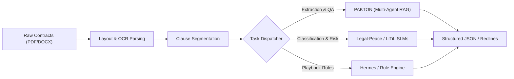

# Awesome Contract AI Model Training & Fine-Tuning ⚖️ 🤖

> A curated directory of state-of-the-art **Contract AI model training frameworks, fine-tuning recipes, legal LLMs, and contract review platforms** (SaaS & open-source).

A comprehensive guide to domain adaptation for legal foundation models, covering **contract analysis, clause classification, contract reasoning, legal NLI (Natural Language Inference), automated redlining, and risk scoring**.

---

## 📑 Table of Contents

- [Overview & Key Concepts](#-overview--key-concepts)
- [Open-Source Models & Frameworks](#-open-source-models--frameworks)
  - [Specialized Legal LLMs & Benchmarks](#specialized-legal-llms--benchmarks)
  - [CLI Tools, RAG & Local Review Engines](#cli-tools-rag--local-review-engines)
- [SaaS & Enterprise Hosted Platforms](#-saas--enterprise-hosted-platforms)
- [Architectural Patterns for Custom Contract AI](#-architectural-patterns-for-custom-contract-ai)
- [How to Contribute](#-how-to-contribute)
- [Disclaimer](#-disclaimer)

---

## 🔍 Overview & Key Concepts

Training and fine-tuning domain-specific AI for contracts requires specialized approaches beyond generic LLMs:

- **Clause Extraction & Classification**: Identifying standard clauses (e.g., Indemnification, Non-Disclosure, Termination, Limitation of Liability) using token-level or sequence-level classification.
- **Contract NLI (Natural Language Inference)**: Determining whether a contract entails, contradicts, or remains neutral toward hypothesis obligations and covenants.
- **Playbook Enforcement & Redlining**: Validating agreements against company-specific negotiation rules and generating automated redlines.
- **Data Sovereignty & On-Premises Privacy**: Leveraging open-source fine-tuned weights (LoRA/QLoRA) deployed inside private VPCs or on-premise infrastructure to protect client confidentiality.

---

## 💻 Open-Source Models & Frameworks

### Specialized Legal LLMs & Benchmarks

Curated open-weight foundation models, legal fine-tunes, and inference benchmarks.

| Project | Stars / Community | Description | Key Focus / Architecture |
|:---|:---:|:---|:---|
| **[Legal-Peace-7B](https://huggingface.co/olaverse/legal-peace-v1.0)** |  | Fine-tuned Mistral-7B-v0.3 model for contract analysis and legal reasoning. Trained with SFT (4,800 cases) + DPO (419 legal reasoning examples). Claims 32.6% faster contract analysis and 14% faster case predictions vs. base Mistral. | SFT + DPO, Mistral-7B, Research/Beta |
| **[LiTiL Open Intelligence Models](https://huggingface.co/collections/litillabs/litil-open-intelligence-models)** |  | Collection of specialized legal AI SLMs/LLMs with modular tasks: legal request router (1.5B), legal intake (4B), PII finder (0.3B), clause check (1.5B), clause tagger (4B), clause classifier (0.4B), contract extractor (1.7B), contract playbook (3B), and financing review (9B). | Small Language Models (SLMs), Task-Specific Agents |
| **[PAKTON](https://aclanthology.org/2025.emnlp-main.403/)** |  | Open-source multi-agent framework for question answering in long legal agreements. Uses collaborative agent workflows and RAG for privacy-preserving contract analysis. Outperforms general-purpose models on predictive accuracy, retrieval, and explainability. | Multi-Agent RAG, Long-Context QA, EMNLP |
| **[contractnli-llms](https://github.com/fbaratov/contractnli-llms)** |  | Code and evaluation for open-source LLMs on legal natural language inference. Evaluates models like Gemma-4 on ContractNLI datasets, demonstrating viable zero-shot and fine-tuned legal inference performance. | Legal NLI, Benchmark Evaluation, Zero-Shot Testing |

### CLI Tools, RAG & Local Review Engines

Self-hosted contract scanners, local redlining suites, and legaltech toolkits.

| Project | Stars / Community | Description | Deployment & Tech Stack |
|:---|:---:|:---|:---|
| **[Hermes Legal Advisor](https://github.com/Lethe044/hermes-legal)** |  | Open-source contract analysis CLI with offline scanner, LLM provider fallback (Groq, Gemini, OpenRouter, Ollama), risk scoring, redlining, and batch processing. Supports custom YAML playbooks. | Python, Docker, Ollama / Local LLM |
| **[contractguardian](https://pypi.org/project/contractguardian/)** |  | Open-source contract scanner supporting PDF, DOCX, TXT, and MD. Identifies agreement categories (lease, NDA, employment, SaaS) and performs red flag detection with fairness grading. | Python CLI / PyPI, Local Ollama / OpenAI |
| **[Contract Review AI](https://github.com/xiaodingfeng/contract-review-v2)** |  | Collaborative contract review platform featuring AI pre-analysis, clause risk flagging, OnlyOffice integration, and vector retrieval (Milvus). | Docker Compose, Milvus, PostgreSQL, MinIO |
| **[awesome-legaltech](https://github.com/chen-friedman/awesome-legaltech)** |  | Curated list of open-source Legal AI tools, datasets, and benchmarks covering document signing, OCR/PDF extraction, and rules-as-code platforms. | Curated Directory, Global Jurisdiction Scope |

---

## 🏢 SaaS & Enterprise Hosted Platforms

Commercial contract intelligence and CLM solutions with AI customization and copilot capabilities.

| Product | Description | Pricing (Starting) | Free Tier / Trial Limits |
|:---|:---|:---|:---|
| **[Icertis AI Studio](https://www.icertis.com/)** | Enterprise CLM platform with proprietary AI model customization. Vera Copilot and autonomous agents trained on enterprise contract corpora for extraction, obligation tracking, and risk analysis. | Quote-only (enterprise contract) | No free tier; demo via sales |
| **[Kira Systems](https://kirasystems.com/)** | Machine-learning contract review and analysis platform (acquired by Litera) with pre-trained models for M&A due diligence and clause extraction. Allows training on custom clause variations. | Quote-only (enterprise contract) | No free tier; demo via sales |
| **[Luminance](https://www.luminance.com/)** | AI contract intelligence and legal process automation utilizing proprietary pattern recognition models trained on large-scale legal datasets. | Quote-only (enterprise contract) | No free tier; trial via sales |
| **[Evisort Studio](https://www.evisort.com/)** | Contract intelligence platform (acquired by Workday) with self-training workflows for custom clause recognition, document classification, and metadata extraction. | $30,000–$60,000/year (small teams); $60,000–$120,000/year (mid-market) | Free trial available; self-serve signup |
| **[Lexion AI](https://www.lexion.ai/)** | AI contract management solution (acquired by Docusign) featuring NLP models trained specifically on commercial agreements and operational extraction. | Quote-only (enterprise contract) | No free trial; sales-led onboarding |
| **[Robin AI](https://www.robinai.com/)** | Contract review copilot powered by Anthropic Claude with domain-specific legal fine-tuning and human-in-the-loop review capabilities. | Quote-only (per-seat or enterprise) | Free trial available via sales |
| **[Spellbook](https://www.spellbook.legal/)** | AI contract drafting and redlining assistant integrated into Microsoft Word, leveraging legal-specific prompt engineering and fine-tuned GPT/Claude models. | Quote-only (per-seat) | Free trial available |
| **[Casetext CoCounsel](https://casetext.com/)** | Legal AI assistant (acquired by Thomson Reuters) powered by GPT-4 with specialized legal reasoning prompts for contract review and due diligence. | Quote-only (per-seat) | No free tier; demo via sales |
| **[Ironclad AI](https://ironcladapp.com/)** | CLM ecosystem featuring an AI Contract Review Agent for automated playbook enforcement, metadata extraction, and redline suggestions. | Quote-only (enterprise contract) | No free tier; demo via sales |

---

## 🏗️ Architectural Patterns for Custom Contract AI

When building or fine-tuning in-house contract intelligence pipelines, consider the following reference stack:

1. **Document Ingestion & OCR**: High-fidelity extraction preserving tabular formatting and layout hierarchy.
2. **Clause Segmentation & Indexing**: Splitting agreements into semantic clauses rather than arbitrary token chunks.
3. **Task-Specific SLMs vs. General LLMs**: Deploying fine-tuned Small Language Models (e.g., LiTiL 1.5B–4B) for high-throughput extraction alongside larger reasoning models for edge-case negotiation analysis.
4. **Local Evaluation (LegalBench)**: Validating domain-specific models against LegalBench thresholds ($F_1 \ge 0.85$) prior to production deployment.

---

## 🤝 How to Contribute

Contributions from researchers, legal engineers, and developers are welcome!

1. **Fork the Repository**
2. **Add or Update Resources**: Ensure entries follow the existing tabular format with verified links, factual descriptions, and accurate pricing/free-tier details where applicable.
3. **Submit a Pull Request**: Provide a concise summary of the addition or revision.

---

## ⚠️ Disclaimer

- This repository is a community-curated resource for research and educational purposes. It does not constitute legal advice.
- Contract AI models handle highly confidential documents; always verify data protection, encryption, and local data residency standards before processing third-party contracts.
- Model performance benchmarks and vendor capabilities are subject to change.
